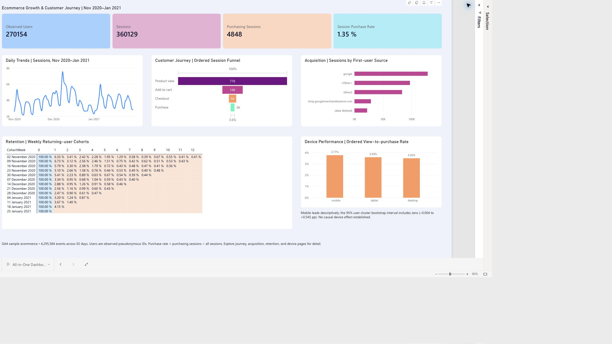
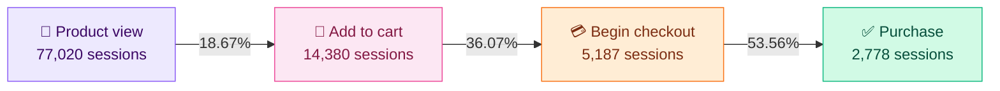
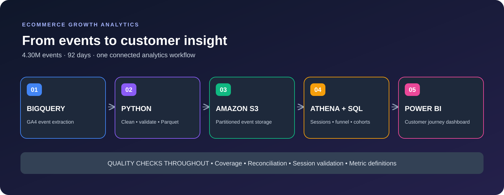
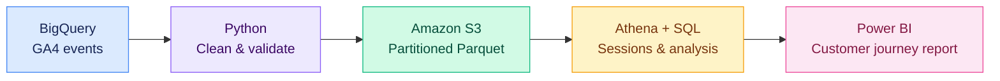

# Ecommerce Growth & Customer Journey

**Python · SQL · BigQuery · Amazon S3 / Athena · Power BI**

An analytics portfolio project investigating conversion, acquisition, device behaviour and weekly retention in Google's historical GA4 ecommerce sample. The pipeline reconciles 4,295,584 events across 92 days and turns them into reviewable SQL, aggregate outputs and genuine Power BI report exports.

**Explore:** [dashboard PDF](ecommerce-growth-analytics/powerbi/ecommerce-growth-dashboard.pdf) · [SQL analyses](ecommerce-growth-analytics/sql/athena/) · [validation record](ecommerce-growth-analytics/data/quality/pipeline_validation_summary.json) · [reproduction guide](ecommerce-growth-analytics/docs/run_data_pipeline.md)

## 🎨 Dashboard preview



*Actual saved Power BI Service capture. The editable report remains in its authenticated workspace; the PNG and PDF are public review artifacts.*

[View dashboard PDF](ecommerce-growth-analytics/powerbi/ecommerce-growth-dashboard.pdf) · [Power BI documentation](ecommerce-growth-analytics/powerbi/README.md) · [Explore SQL queries](ecommerce-growth-analytics/sql/athena/)

Seven report pages connect the executive summary with the analysis behind it:

| Overview & behavior | Growth & performance |
| :--- | :--- |
| Executive Overview | Acquisition |
| Customer Journey | Weekly Retention |
| Daily Trends | Device Performance |

**All-in-One Dashboard:** the final page brings every section together in a single colorful view.

## 🔎 Questions behind the dashboard

| Customer journey | Growth & retention |
| :--- | :--- |
| Where do sessions leave the purchase funnel? | Which acquisition sources bring purchasing activity? |
| How does conversion vary by device? | How often do weekly cohorts return? |
| How do sessions and purchase rates change daily? | Where should further investigation begin? |

## 📊 The numbers

| Events analyzed | Observed users | Sessions | Purchasing sessions |
| :---: | :---: | :---: | :---: |
| **4,295,584** | **270,154** | **360,129** | **4,848** |

> **1.35%** overall session purchase rate · **3.61%** ordered product-view-to-purchase conversion  
> Analysis window: **1 November 2020 – 31 January 2021** · **92 days**

### Customer journey



| Ordered funnel stage | Sessions | Retained from previous stage |
| :--- | ---: | ---: |
| Product view | 77,020 | — |
| Add to cart | 14,380 | 18.67% |
| Begin checkout | 5,187 | 36.07% |
| Purchase | 2,778 | 53.56% |

The largest observed loss occurs between product view and add to cart: **62,640 sessions**, or **81.33%** of product-view sessions, do not reach the next ordered stage. This is a starting point for investigating product discovery, merchandising, and tracking coverage; it does not establish the cause of abandonment.

**Metric definitions matter:** the overall purchase rate uses all sessions. The ordered funnel requires product view → cart → checkout → purchase in chronological order within the same session, so its denominator and purchase count differ.

## ⚙️ How it works





| Layer | Work completed |
| :--- | :--- |
| Extraction | Daily event extraction and coverage checks in BigQuery |
| Preparation | Python cleaning, count reconciliation, and Parquet preparation |
| Cloud analytics | S3 storage, Athena external table, date partitions, and session views |
| Analysis | Ordered funnel, acquisition, device, daily trends, and cohort retention SQL |
| Reporting | Seven Power BI pages with a colorful combined summary |
| Validation | Coverage, pipeline, upload, and session validation reports |

## 📁 Explore the project

| Location | Contents |
| :--- | :--- |
| [sql/bigquery/](ecommerce-growth-analytics/sql/bigquery/) | Extraction and daily coverage queries |
| [sql/athena/](ecommerce-growth-analytics/sql/athena/) | Table definitions, session views, validation, and analysis queries |
| [src/](ecommerce-growth-analytics/src/) | Python extraction, cleaning, validation, and data preparation scripts |
| [data/analytics/](ecommerce-growth-analytics/data/analytics/) | Aggregate funnel, acquisition, device, trend, and retention exports |
| [data/quality/](ecommerce-growth-analytics/data/quality/) | Reconciliation and validation outputs |
| [aws/](ecommerce-growth-analytics/aws/) | Deployment configuration and AWS reproduction instructions |
| [powerbi/](ecommerce-growth-analytics/powerbi/) | Dashboard PNG/PDF, aggregate import CSV, optional DAX, and report manifest |
| [docs/](ecommerce-growth-analytics/docs/) | Pipeline instructions and supporting documentation |

Full raw, processed, and Parquet event datasets are kept locally and excluded from Git. The repository contains aggregate results for review.

## 🚀 Explore or reproduce

**To review the project:** start with the dashboard above, inspect the [aggregate results](ecommerce-growth-analytics/data/analytics/), and read the [Athena SQL](ecommerce-growth-analytics/sql/athena/). No cloud account is required to view these files.

**To run the pipeline:** use Python 3, enter the nested project directory, and create an isolated environment:

```bash
git clone https://github.com/jatothnithinsai-tech/ecommerce-growth-analytics.git
cd ecommerce-growth-analytics/ecommerce-growth-analytics
python -m venv .venv
# Activate .venv for your shell, then:
python -m pip install -r requirements.txt
# Copy config.example.json to config.json and enter your own project settings.
```

Configure your own authorized cloud access and review [the pipeline instructions](ecommerce-growth-analytics/docs/run_data_pipeline.md) before running extraction or cloud queries. Keep `config.json`, credentials, and event-level datasets out of Git. The example configuration is a starter; the example and historical deployment use different regions, so align your region and bucket settings before running; see [the recorded AWS configuration](ecommerce-growth-analytics/aws/deployment_config.json) for the original deployment settings.

**To rebuild the dashboard:** import [dashboard_data.csv](ecommerce-growth-analytics/powerbi/dashboard_data.csv) as `DashboardData` and follow the [Power BI guide](ecommerce-growth-analytics/powerbi/README.md). The file contains multiple aggregate grains: filter each visual to its appropriate `RowType`; do not sum distinct users or precomputed rates across unrelated groups.

## 🧭 Read the results responsibly

<details>
<summary><strong>Definitions, assumptions, and limitations</strong></summary>

- The dataset is Google's **obfuscated historical GA4 sample**, not a current production store.
- Users are pseudonymous observed identifiers, not verified individuals. First-observed cohorts do not prove first-ever customer acquisition.
- Acquisition fields describe **first-user attribution**, not session-level attribution.
- Engagement flags are incomplete, and event tracking gaps can affect funnel interpretation.
- Device comparisons are observational. The reported mobile–desktop confidence interval includes zero; no causal uplift or completed A/B experiment is claimed.
- Retention uses first-observed weekly cohorts and eligible completed follow-up weeks. Future unavailable weeks remain blank.
- No validated net revenue metric is presented.

</details>

## ✅ Deliverables & status

The Power BI report was authored in **Power BI Service**. This repository includes actual dashboard image and PDF exports; the editable report remains in the authenticated workspace. A `.pbix` file is not included.

The existing project handover records that its S3 bucket and `ga4_growth` Glue database were deleted after the exports were saved. This GitHub portfolio review did not access AWS or independently recheck billing/resource state. Reviewing the exports requires no active cloud resources.

The repository contains recorded coverage/count/checksum validation, not an automated unit-test suite. No fresh cloud execution, ongoing production deployment or realized conversion uplift is claimed.

## 🌐 Dataset & useful links

### Original data

**Google's GA4 obfuscated ecommerce sample** contains historical event data from the Google Merchandise Store. This project analyzes **1 November 2020–31 January 2021**.

| Resource | Link |
| :--- | :--- |
| Official dataset description and access instructions | [Google Analytics ecommerce sample](https://developers.google.com/analytics/bigquery/web-ecommerce-demo-dataset) |
| Public BigQuery dataset | [Open dataset in BigQuery](https://console.cloud.google.com/bigquery?p=bigquery-public-data&d=ga4_obfuscated_sample_ecommerce&page=dataset) |
| GA4 event export field reference | [BigQuery export schema](https://support.google.com/analytics/answer/7029846) |

```sql
-- Public source tables used for extraction
`bigquery-public-data.ga4_obfuscated_sample_ecommerce.events_*`
```

BigQuery access requires your own Google account and project; query usage may incur costs. Full event files are excluded from this repository. The following project outputs are available directly on GitHub.

### Explore the analysis

| Analysis | Data output | SQL |
| :--- | :--- | :--- |
| Ordered customer journey | [Funnel summary](ecommerce-growth-analytics/data/analytics/ordered_funnel_summary.csv) | [Ordered funnel definition](ecommerce-growth-analytics/sql/athena/03_ordered_funnel.sql) |
| Acquisition sources | [Acquisition summary](ecommerce-growth-analytics/data/analytics/first_user_acquisition_summary.csv) | [Acquisition query](ecommerce-growth-analytics/sql/athena/04_acquisition.sql) |
| Device performance | [Device funnel](ecommerce-growth-analytics/data/analytics/device_funnel_summary.csv) | [Device query](ecommerce-growth-analytics/sql/athena/08_device_funnel.sql) |
| Weekly retention | [Cohort retention](ecommerce-growth-analytics/data/analytics/weekly_cohort_retention.csv) | [Retention query](ecommerce-growth-analytics/sql/athena/05_retention.sql) |
| Daily trends | [Daily sessions](ecommerce-growth-analytics/data/analytics/daily_session_trends.csv) | [Daily trends query](ecommerce-growth-analytics/sql/athena/10_daily_session_trends.sql) |
| First vs. subsequent sessions | [Session segments](ecommerce-growth-analytics/data/analytics/first_vs_subsequent_sessions.csv) | [Segmentation query](ecommerce-growth-analytics/sql/athena/09_first_vs_subsequent_sessions.sql) |

### Dashboard & project resources

- **[Dashboard PDF](ecommerce-growth-analytics/powerbi/ecommerce-growth-dashboard.pdf)** — the colorful combined view on one page.
- **[Dashboard image](ecommerce-growth-analytics/powerbi/ecommerce-growth-dashboard.png)** — portfolio preview.
- **[Power BI import data](ecommerce-growth-analytics/powerbi/dashboard_data.csv)** — aggregate dataset used by the report.
- **[Power BI build notes](ecommerce-growth-analytics/powerbi/README.md)** — report pages, metric definitions, and visual filters.
- **[Pipeline guide](ecommerce-growth-analytics/docs/run_data_pipeline.md)** — extraction, cleaning, and validation workflow.
- **[AWS reproduction guide](ecommerce-growth-analytics/aws/README.md)** — original cloud setup and configuration.

The interactive report requires access to its authenticated Power BI workspace. The PDF and image above are available for portfolio review without signing in to Power BI.

---

<div align="center">

**Built by [Nithinsai Jatoth](https://github.com/jatothnithinsai-tech)**  
[Explore the repository](https://github.com/jatothnithinsai-tech/ecommerce-growth-analytics)

</div>
